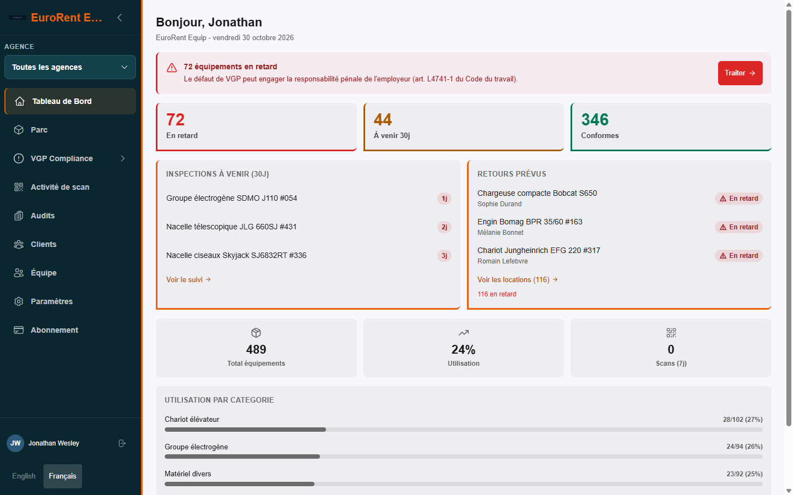
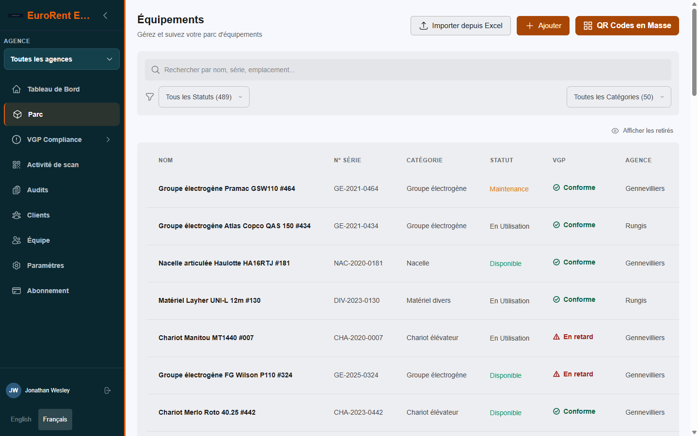
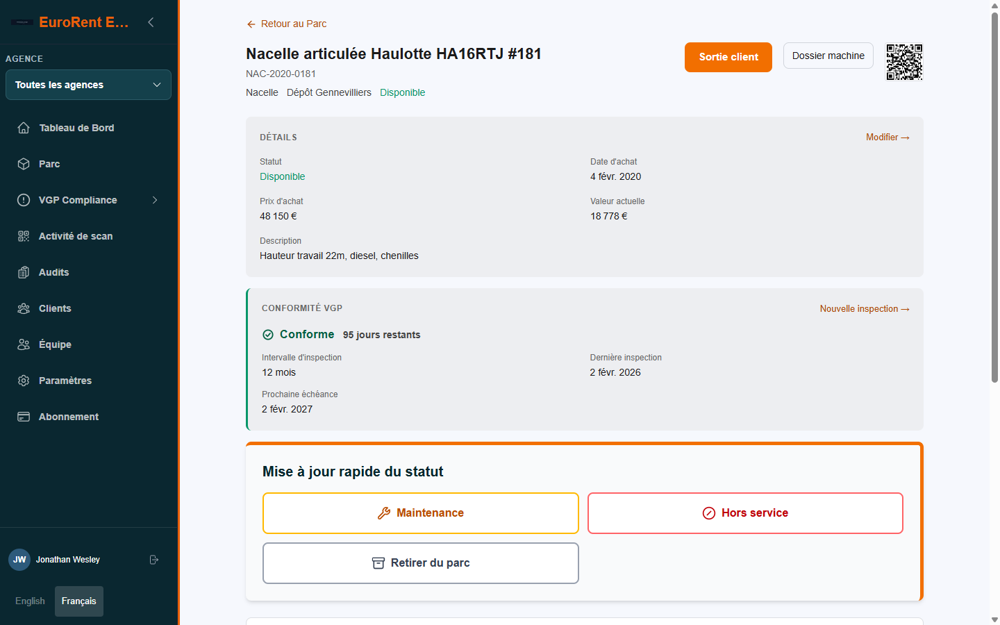
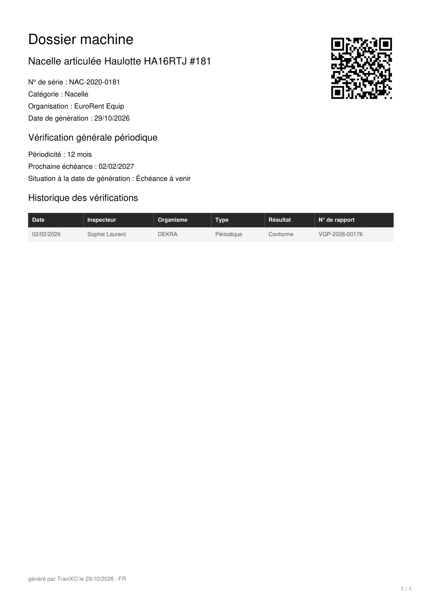
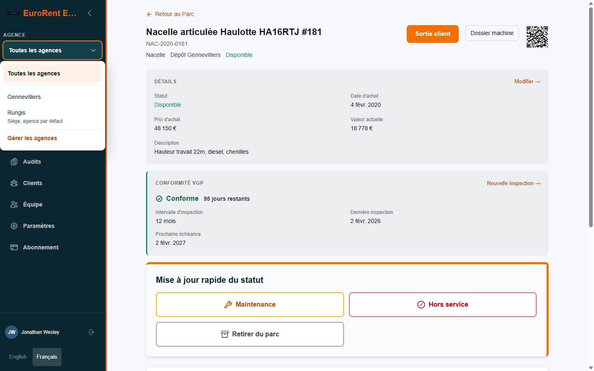

# TraviXO: equipment tracking and VGP compliance

**Product:** [travixosystems.com](https://travixosystems.com) · **Application:** [app.travixosystems.com](https://app.travixosystems.com) · **Portfolio:** [deralis.digital](https://deralis.digital/en/projects)

> This repository holds an early demo from March 2026. The current product is private and is described below.

TraviXO is a B2B product I designed and built alone for equipment rental companies in France. It keeps each machine
linked to its rentals, its documents and its regulatory inspections (VGP), from check-out to return. It is my own
product, not a commissioned project, and it has no paying customers yet.

---

## What the current product does

- Identify each machine by QR code; check it out and back in from the machine page or a scan.
- Link client records to rentals, so an inspection recall reaches the client who has the machine.
- Schedule VGP inspections with 24 regulatory profiles, chosen per machine rather than guessed.
- Warn when an inspection falls due before the expected return date.
- Send VGP alerts per person, with a weekly digest and individual preferences.
- Produce a machine dossier PDF (inspection record plus certificates) and email it to the client at check-out.
- Run several agencies under one account, with an agency switcher and per-agency fleet views.
- Bill on licensed asset capacity through Stripe.

## How it is built

Next.js · TypeScript · Supabase (PostgreSQL, row-level security) · Stripe · pdf-lib · Resend · Vercel

- Multi-tenant: every table is scoped to an organisation, and isolation is enforced by row-level security in the
  database, not only in application code.
- Billing capacity is enforced by a database trigger; Stripe webhooks are signature-verified and each event is claimed
  before it is applied, so a retried event cannot be processed twice.
- 103 database migrations as of October 2026.

## How it is verified

- **Multi-tenant security audit (September 2026):** critical findings closed one by one, each with evidence and a
  runbook (billing authority, role gates on billing routes, rental custody writes through database functions only).
  Follow-up hardening removed permissive insert policies and blocked asset writes for read-only roles.
- **Behavioural tests against a real PostgreSQL** for row-level security, the role matrix, ownership transfer and
  cross-tenant access (another organisation's machine dossier returns 404).
- **Privacy gate:** a static check fails verification if the dossier code reads client, rental or price data, or
  prints a blanket compliance claim. It is tested against a bad fixture to prove it rejects one.
- **Load and performance:** a k6 load-test harness and a measured performance pass (parallel dashboard loading,
  server-side pagination, indexes on uncovered foreign keys).
- **Read-only production proofs** after each multi-agency database change.

## Screenshots

Captured from the live application on 30 October 2026, on a demo organisation with fictional data.

**Dashboard:** overdue, upcoming and compliant machines, inspections due in the next 30 days, expected returns.



**Fleet:** every machine with its status, VGP state and agency.



**Machine record:** compliance at a glance, check-out from the machine page, quick status changes.



**Machine dossier (PDF):** the inspection record generated for the client at check-out.



**Agencies:** one account, several agencies, a switcher in the sidebar.



---

## What is in this repository

The March 2026 demo of TraviXO: Next.js App Router, Supabase, Stripe, React Email and UploadThing. It predates the
work described above (multi-agency, machine dossier, capacity billing, the security audit).

```bash
npm install
cp .env.example .env.local   # Supabase, Stripe, Resend and UploadThing credentials
npm run dev                  # http://localhost:3000
```

Some configuration values are placeholders.

---

Built by [Uwa Chidera Ugboaja](https://github.com/theWQLker) · [deralis.digital](https://deralis.digital)
